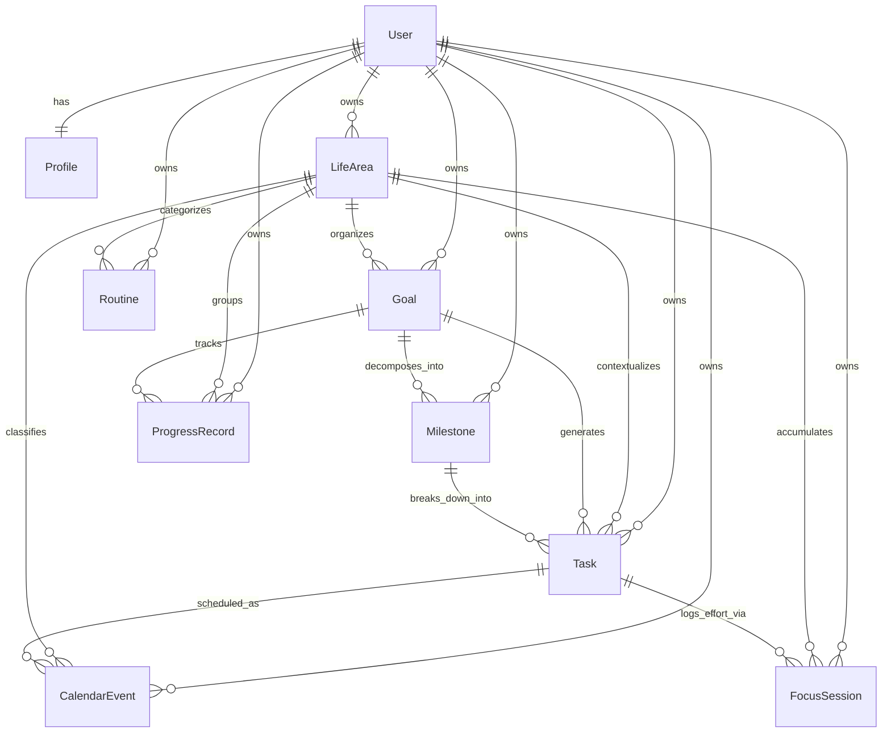

# Aether — Core Data Model Specification

**Status:** Specification Only — Conceptual Architecture (Checkpoint 5.1)  
**Governing Documents:** `docs/TECHNICAL_DESIGN.md`, `FEATURES.md`, `DESIGN.md`, `docs/TDS.md`  
**Execution Rule:** No database migrations, Supabase tables, or data-access code are implemented in this checkpoint.

---

## 1. Architectural Modeling Principles

1. **One Canonical Task Model:**  
   Tasks are shared universally across all workspaces (Today, Calendar, Goals, Life Areas). Academic assignments, goal milestones, and fitness tasks all resolve to the single canonical `Task` record. Domain-specific extensions are captured via typed metadata, never via parallel, disconnected task tables.

2. **Strict User Ownership and RLS Isolation:**  
   Every persisted record carries a non-nullable `user_id` foreign key referencing `auth.users.id`. In accordance with `docs/TECHNICAL_DESIGN.md §7`, all tables require Supabase Row Level Security (RLS) policies enforcing `WHERE user_id = auth.uid()`. One user can never query or mutate another user's records.

3. **Separation of Concerns across Execution Layers:**  
   - `Goal`: High-level aspiration and target outcome.
   - `Milestone`: Verifiable intermediate checkpoint.
   - `Task`: Atomic actionable unit of execution.
   - `Routine`: Recurrence rule and behavioral template.
   - `CalendarEvent`: Time-blocked schedule commitment on a timeline.
   - `FocusSession`: Dedicated logged effort interval.

4. **FocusSession and Task Independence (LOCKED §4.2a):**  
   Completing a `FocusSession` logs effort and duration but **never marks the linked `Task` as completed**. Task completion is an explicit, independent user action.

5. **Historical Integrity & Safe Lifecycle Rules:**  
   Archiving or updating a `LifeArea` or `Goal` must never cascade-delete or corrupt historical `Task`, `FocusSession`, or `ProgressRecord` entries. Soft-deletion (`archived_at`) is preferred over destructive `CASCADE DELETE`.

6. **Derived Data Rule (LOCKED §4.4):**  
   Mutable calculated values (goal completion percentage, streak counts, attendance percentages, trajectory status, and schedule conflicts) are **not stored as authoritative database state**. They are computed deterministically in the Domain layer (`src/domain/`) from raw underlying records given an explicit reference timestamp.

7. **Routine Definition vs. Occurrence:**  
   A `Routine` defines the cadence and schedule rule. Daily executions generate or link to daily `Task` instances or lightweight occurrence records, preventing conflation between the recurring rule and individual day logs.

8. **Calendar Events vs. Tasks:**  
   `CalendarEvent` represents a scheduled time block (start and end timestamps). It may link to a `Task` (scheduling a task into a specific time slot) or represent an independent external commitment (e.g., classes, lectures, exams, medical appointments).

---

## 2. Entity Relationship Map (ERD)

---

## 3. Core Entity Specifications

### 3.1 User & Profile (`Profile`)

* **Authoritative Responsibility:** Stores user preferences, operational time zone, academic timeline boundaries, and personal capacity baselines.
* **User Ownership:** 1:1 with Supabase Auth `auth.users` (`id = auth.uid()`).
* **Core Attributes:**
  - `user_id` (UUID, PK, FK -> `auth.users.id`, non-nullable)
  - `full_name` (Text, nullable)
  - `timezone` (Text, default `'UTC'`, non-nullable) — *critical for deterministic date/time calculations*
  - `target_sleep_hours` (Numeric, default `8.0`, non-nullable)
  - `daily_focus_capacity_minutes` (Integer, default `240`, non-nullable)
  - `current_term_id` (UUID, nullable, FK -> future `AcademicTerm`)
  - `created_at` (Timestamp with time zone, default `now()`)
  - `updated_at` (Timestamp with time zone, default `now()`)
* **Integrity & Constraints:**
  - RLS: `user_id = auth.uid()` for select, update, insert.
  - Deleting an auth user removes the profile via cascade delete.
* **Derived (Not Stored):**
  - Account age, daily capacity utilization percentage.

---

### 3.2 Life Area (`LifeArea`)

* **Authoritative Responsibility:** Defines the high-level operating domains of the user's life (Academics, Health & Fitness, Skills & Career, Sleep & Recovery, Relationships, Personal, or custom user domains).
* **User Ownership:** Belongs to `user_id`.
* **Cardinality:** 1 User : N LifeAreas.
* **Core Attributes:**
  - `id` (UUID, PK, default `gen_random_uuid()`)
  - `user_id` (UUID, FK -> `auth.users.id`, non-nullable)
  - `name` (Text, non-nullable) — e.g. "Academics", "Health & Fitness"
  - `slug` (Text, non-nullable) — e.g. "academics", "health"
  - `accent_color` (Text, non-nullable) — semantic hex/color token
  - `icon_name` (Text, non-nullable) — Lucide icon identifier
  - `priority_weight` (Integer, default `1`) — used by Life Sync to resolve scheduling trade-offs
  - `is_system_default` (Boolean, default `false`)
  - `archived_at` (Timestamp with time zone, nullable)
  - `created_at` (Timestamp with time zone, default `now()`)
  - `updated_at` (Timestamp with time zone, default `now()`)
* **Integrity & Constraints:**
  - Unique constraint on `(user_id, slug)` where `archived_at IS NULL`.
  - **No Cascade Deletion:** When a LifeArea is archived, connected Goals, Tasks, and FocusSessions remain intact.
* **Derived (Not Stored):**
  - Active goal count, total focus hours, health beacon state.

---

### 3.3 Goal (`Goal`)

* **Authoritative Responsibility:** Represents a meaningful outcome or aspiration situated within a specific life area over a multi-week, monthly, or semester horizon.
* **User Ownership:** Belongs to `user_id`.
* **Cardinality:** 1 LifeArea : N Goals. 1 Goal : N Milestones. 1 Goal : N Tasks.
* **Core Attributes:**
  - `id` (UUID, PK, default `gen_random_uuid()`)
  - `user_id` (UUID, FK -> `auth.users.id`, non-nullable)
  - `life_area_id` (UUID, FK -> `LifeArea.id`, non-nullable)
  - `title` (Text, non-nullable)
  - `description` (Text, nullable)
  - `target_date` (Date, nullable)
  - `status` (Enum: `'not_started'`, `'in_progress'`, `'paused'`, `'achieved'`, `'abandoned'`, default `'not_started'`)
  - `priority` (Enum: `'low'`, `'medium'`, `'high'`, `'critical'`, default `'medium'`)
  - `measurement_type` (Enum: `'milestones'`, `'numeric_metric'`, `'habitual'`, default `'milestones'`)
  - `target_value` (Numeric, nullable) — for quantitative targets (e.g., target GPA or hours)
  - `unit` (Text, nullable) — e.g. "chapters", "km", "hours"
  - `completed_at` (Timestamp with time zone, nullable)
  - `archived_at` (Timestamp with time zone, nullable)
  - `created_at` (Timestamp with time zone, default `now()`)
  - `updated_at` (Timestamp with time zone, default `now()`)
* **Integrity & Constraints:**
  - FK to `LifeArea` with `ON DELETE RESTRICT` (life area cannot be deleted while goals exist; must archive instead).
  - `completed_at` must be populated when status changes to `'achieved'`.
* **Derived (Not Stored):**
  - `progress_percentage`: computed from completed milestones and tasks.
  - `trajectory_status`: calculated by comparing progress rate against time remaining until `target_date`.

---

### 3.4 Milestone (`Milestone`)

* **Authoritative Responsibility:** A verifiable intermediate checkpoint required to fulfill a Goal.
* **User Ownership:** Belongs to `user_id`.
* **Cardinality:** 1 Goal : N Milestones. 1 Milestone : N Tasks.
* **Core Attributes:**
  - `id` (UUID, PK, default `gen_random_uuid()`)
  - `user_id` (UUID, FK -> `auth.users.id`, non-nullable)
  - `goal_id` (UUID, FK -> `Goal.id`, non-nullable)
  - `title` (Text, non-nullable)
  - `description` (Text, nullable)
  - `target_date` (Date, nullable)
  - `sort_order` (Integer, default `0`, non-nullable)
  - `status` (Enum: `'pending'`, `'completed'`, default `'pending'`)
  - `completed_at` (Timestamp with time zone, nullable)
  - `created_at` (Timestamp with time zone, default `now()`)
  - `updated_at` (Timestamp with time zone, default `now()`)
* **Integrity & Constraints:**
  - FK to `Goal` with `ON DELETE CASCADE` (deleting a goal deletes its intermediate milestone markers).
  - If tasks reference this milestone, tasks are reassigned directly to `goal_id` (`ON DELETE SET NULL` on `task.milestone_id`).
* **Derived (Not Stored):**
  - Task completion count, total focus time logged toward this milestone.

---

### 3.5 Task (`Task`) — CANONICAL MODEL

* **Authoritative Responsibility:** The single atomic actionable unit of execution in Aether. All academic assignments, daily checklist items, goal subtasks, and habit instances map to this record.
* **User Ownership:** Belongs to `user_id`.
* **Cardinality:** 1 LifeArea : N Tasks. 0..1 Goal : N Tasks. 0..1 Milestone : N Tasks. 1 Task : N FocusSessions.
* **Core Attributes:**
  - `id` (UUID, PK, default `gen_random_uuid()`)
  - `user_id` (UUID, FK -> `auth.users.id`, non-nullable)
  - `life_area_id` (UUID, FK -> `LifeArea.id`, non-nullable)
  - `goal_id` (UUID, FK -> `Goal.id`, nullable)
  - `milestone_id` (UUID, FK -> `Milestone.id`, nullable)
  - `title` (Text, non-nullable)
  - `description` (Text, nullable)
  - `status` (Enum: `'todo'`, `'in_progress'`, `'completed'`, `'cancelled'`, default `'todo'`)
  - `priority` (Enum: `'low'`, `'medium'`, `'high'`, `'urgent'`, default `'medium'`)
  - `due_date` (Timestamp with time zone, nullable) — *the hard deadline*
  - `scheduled_date` (Date, nullable) — *the planned day of execution*
  - `estimated_duration_minutes` (Integer, nullable)
  - `completed_at` (Timestamp with time zone, nullable)
  - `source_type` (Enum: `'manual'`, `'routine'`, `'academic'`, `'quick_log'`, default `'manual'`)
  - `source_id` (UUID, nullable) — references originating entity (e.g. `routine_id`, `assignment_id`)
  - `metadata` (JSONB, default `'{}'::jsonb`) — typed domain-specific extensions (e.g. course code, reading chapter)
  - `created_at` (Timestamp with time zone, default `now()`)
  - `updated_at` (Timestamp with time zone, default `now()`)
* **Integrity & Invariants:**
  - When `status` transitions to `'completed'`, `completed_at` is set to `now()`.
  - **LOCKED Invariant (§4.2a):** Inserting or updating a `FocusSession` does NOT mutate `Task.status` or `Task.completed_at`.
* **Derived (Not Stored):**
  - `total_focus_duration`: sum of all completed `FocusSession.active_duration_seconds`.
  - `is_overdue`: `due_date < now() AND status != 'completed'`.

---

### 3.6 Routine (`Routine`)

* **Authoritative Responsibility:** Defines recurring behavioral templates and habits across life areas without conflating the recurrence rule with daily execution logs.
* **User Ownership:** Belongs to `user_id`.
* **Cardinality:** 1 LifeArea : N Routines.
* **Core Attributes:**
  - `id` (UUID, PK, default `gen_random_uuid()`)
  - `user_id` (UUID, FK -> `auth.users.id`, non-nullable)
  - `life_area_id` (UUID, FK -> `LifeArea.id`, non-nullable)
  - `title` (Text, non-nullable) — e.g. "Daily Discrete Math Review", "Evening Workout"
  - `description` (Text, nullable)
  - `frequency_type` (Enum: `'daily'`, `'weekdays'`, `'custom_days'`, `'interval_days'`, default `'daily'`)
  - `schedule_rule` (JSONB, non-nullable) — e.g. `{"days": [1, 3, 5]}` for MWF
  - `preferred_time_of_day` (Enum: `'morning'`, `'afternoon'`, `'evening'`, `'anytime'`, default `'anytime'`)
  - `target_duration_minutes` (Integer, nullable)
  - `is_active` (Boolean, default `true`, non-nullable)
  - `streak_eligible` (Boolean, default `true`, non-nullable)
  - `created_at` (Timestamp with time zone, default `now()`)
  - `updated_at` (Timestamp with time zone, default `now()`)
* **Occurrence Architecture:**
  When a routine is active on a given date, the domain layer surfaces a scheduled task or checklist item with `source_type = 'routine'` and `source_id = routine.id`. The occurrence record is marked complete independently, preserving the parent `Routine` definition untouched.
* **Derived (Not Stored):**
  - Current streak, longest streak, historical adherence percentage.

---

### 3.7 Calendar Event (`CalendarEvent`)

* **Authoritative Responsibility:** Represents a fixed time block on the user's schedule with designated start and end timestamps.
* **User Ownership:** Belongs to `user_id`.
* **Cardinality:** 1 LifeArea : N CalendarEvents. 0..1 Task : 0..N CalendarEvents.
* **Core Attributes:**
  - `id` (UUID, PK, default `gen_random_uuid()`)
  - `user_id` (UUID, FK -> `auth.users.id`, non-nullable)
  - `life_area_id` (UUID, FK -> `LifeArea.id`, non-nullable)
  - `task_id` (UUID, FK -> `Task.id`, nullable) — links scheduled timeblock to an actionable task
  - `title` (Text, non-nullable)
  - `description` (Text, nullable)
  - `start_time` (Timestamp with time zone, non-nullable)
  - `end_time` (Timestamp with time zone, non-nullable)
  - `is_all_day` (Boolean, default `false`, non-nullable)
  - `event_type` (Enum: `'class_timetable'`, `'study_block'`, `'exam'`, `'personal'`, `'task_block'`, default `'personal'`)
  - `location` (Text, nullable)
  - `is_recurring` (Boolean, default `false`, non-nullable)
  - `recurrence_rule` (JSONB, nullable)
  - `created_at` (Timestamp with time zone, default `now()`)
  - `updated_at` (Timestamp with time zone, default `now()`)
* **Integrity & Constraints:**
  - Check constraint: `end_time > start_time`.
  - FK to `Task` uses `ON DELETE SET NULL`: deleting a task does not delete the calendar time block.
* **Derived (Not Stored):**
  - Duration in minutes, overlap/conflict status against other events.

---

### 3.8 Focus Session (`FocusSession`)

* **Authoritative Responsibility:** An immutable record of dedicated, active time invested in a specific task, milestone, or life area.
* **User Ownership:** Belongs to `user_id`.
* **Cardinality:** 1 User : N FocusSessions. 0..1 Task : N FocusSessions. 1 LifeArea : N FocusSessions.
* **Core Attributes:**
  - `id` (UUID, PK, default `gen_random_uuid()`)
  - `user_id` (UUID, FK -> `auth.users.id`, non-nullable)
  - `life_area_id` (UUID, FK -> `LifeArea.id`, non-nullable)
  - `task_id` (UUID, FK -> `Task.id`, nullable)
  - `started_at` (Timestamp with time zone, non-nullable)
  - `ended_at` (Timestamp with time zone, nullable)
  - `target_duration_seconds` (Integer, default `1500`, non-nullable) — e.g. 25 min default
  - `active_duration_seconds` (Integer, default `0`, non-nullable) — *actual elapsed focus time*
  - `paused_duration_seconds` (Integer, default `0`, non-nullable) — *total paused time*
  - `pause_intervals` (JSONB, default `'[]'::jsonb`) — array of `[{"paused_at": string, "resumed_at": string}]`
  - `status` (Enum: `'active'`, `'paused'`, `'completed'`, `'abandoned'`, default `'active'`)
  - `distraction_count` (Integer, default `0`, non-nullable)
  - `reflection_note` (Text, nullable)
  - `created_at` (Timestamp with time zone, default `now()`)
  - `updated_at` (Timestamp with time zone, default `now()`)
* **Integrity & Invariants:**
  - **LOCKED (§4.2a):** `status = 'completed'` does NOT trigger task completion.
  - Active time is calculated from timestamps: `active_duration_seconds = (ended_at - started_at) - paused_duration_seconds`.
* **Derived (Not Stored):**
  - Contribution to weekly focus target, streak qualification signal.

---

### 3.9 Progress Record (`ProgressRecord`)

* **Authoritative Responsibility:** Quantitative, timestamped data points tracking concrete progress metrics (e.g. pages read, course modules completed, weight logged, coding problems solved).
* **User Ownership:** Belongs to `user_id`.
* **Cardinality:** 1 User : N ProgressRecords. 1 LifeArea : N ProgressRecords. 0..1 Goal : N ProgressRecords.
* **Core Attributes:**
  - `id` (UUID, PK, default `gen_random_uuid()`)
  - `user_id` (UUID, FK -> `auth.users.id`, non-nullable)
  - `life_area_id` (UUID, FK -> `LifeArea.id`, non-nullable)
  - `goal_id` (UUID, FK -> `Goal.id`, nullable)
  - `recorded_date` (Date, non-nullable)
  - `metric_name` (Text, non-nullable) — e.g. "discrete_math_problems", "workout_volume"
  - `numeric_value` (Numeric, non-nullable)
  - `unit` (Text, nullable) — e.g. "problems", "kg", "minutes"
  - `notes` (Text, nullable)
  - `created_at` (Timestamp with time zone, default `now()`)
* **Integrity & Constraints:**
  - Append-only / audit log: records are rarely updated once written, supporting historical trend charts in Insights.
* **Derived (Not Stored):**
  - Moving averages, rate of progress, comparison against prior period.

---

## 4. Future Entities Requiring Dedicated Design

These entities belong to upcoming checkpoints and are formally identified here to ensure the core data model leaves clean architectural boundaries:

1. **Academic Domain (Academics Workspace):**
   - `AcademicTerm`: Academic semester/term bounds (`start_date`, `end_date`, `name`, `is_current`).
   - `Course`: Subject/course model (`code`, `name`, `credits`, `color`, `target_attendance_percentage`).
   - `TimetableSlot`: Class schedule templates (`course_id`, `day_of_week`, `start_time`, `end_time`, `room`).
   - `AttendanceRecord`: Class attendance logs (`course_id`, `date`, `status: attended/absent/excused/cancelled`).
   - `Assessment`: Assignments, exams, and quizzes with syllabus weights (`course_id`, `type`, `weight_percentage`, `max_score`, `score_achieved`).

2. **Sleep & Recovery Domain (Sleep Workspace):**
   - `SleepRecord`: Nightly sleep and wake logs (`bed_time`, `wake_time`, `duration_minutes`, `subjective_rating: 1-5`, `recovery_score`).

3. **Activity & Fitness Domain (Health Workspace):**
   - `ActivityRecord`: Physical workouts and fitness logs (`activity_type`, `duration_minutes`, `metrics_json`).

4. **Streak Governance & Momentum:**
   - `StreakConfig`: Rules defining what constitutes activity for a streak (routine, focus time, or task completion).
   - `StreakHistory`: Snapshot history of streak freezes, pauses, and milestones.

5. **Reviews & Reflection (Insights & AI Workspace):**
   - `WeeklyReview`: Structured weekly reflection notes, highlight summaries, and adjustment plans.
   - `ContextSnapshot`: Pre-aggregated context payloads fed to the AI assistant (Ask mode).

---

## 5. Unresolved Decisions & Architectural Recommendations

| Topic | Current Stance | Next Action / Resolution Checkpoint |
|---|---|---|
| **Soft Delete vs. Hard Delete** | Default to `archived_at IS NULL` for user-facing deletion to preserve historical analytics. | Formally validate foreign key cascade behaviors during database migration design. |
| **Cross-Area Goal Linking** | Primary goal belongs to 1 Life Area; cross-domain impact is expressed via relationships or tags in `metadata`. | Implement junction table `goal_cross_areas` if secondary area tracking proves necessary. |
| **Recurrence Engine** | Recurrence rules stored as ISO/iCalendar standard JSON structures; generation handled by pure TS domain functions. | Implement occurrence generator in `src/domain/` with Vitest unit tests before database persistence. |
| **Calendar Sync Integration** | Internal `CalendarEvent` is canonical. External Google Calendar / Outlook integration is deferred. | Design external sync mapper during Calendar feature implementation. |
